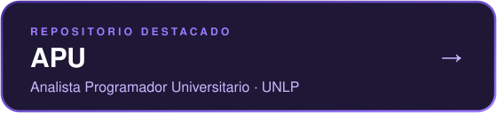
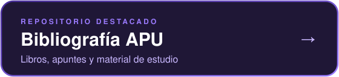

<h2 align="center">📂 Recursos para la facultad</h2>

Todo el material que fui juntando a lo largo de la carrera: apuntes, parciales, ejercicios y más.

  

<i>El material compartido es de carácter personal y no representa contenidos oficiales ni resoluciones aprobadas por ninguna cátedra.</i>

<h2 align="center">🎓 Carrera APU</h2>

  
   
  

 

<table align="center">
  <tr>
    <td align="center"></td>
    <td align="center"></td>
    <td align="center"></td>
  </tr>
  <tr>
    <td valign="top">
      &nbsp;▸&ensp;<a href="https://github.com/MatiasGuaymas/CADP"><b>CADP</b></a> 
      &nbsp;▸&ensp;<a href="https://github.com/MatiasGuaymas/OC"><b>Organización de Computadoras</b></a> 
      &nbsp;▸&ensp;<a href="https://github.com/MatiasGuaymas/Taller-Programacion"><b>Taller de Programación</b></a> 
      &nbsp;▸&ensp;<a href="https://github.com/MatiasGuaymas/Arquitectura-Computadoras"><b>Arquitectura de Computadoras</b></a> 
       
      &nbsp;🗂&ensp;<a href="https://github.com/MatiasGuaymas/1er-Semestre">1er Semestre</a> · <a href="https://github.com/MatiasGuaymas/2do-Semestre">2do Semestre</a>
    </td>
    <td valign="top">
      &nbsp;▸&ensp;<a href="https://github.com/MatiasGuaymas/AYED"><b>Algoritmos y Estructuras de Datos</b></a> 
      &nbsp;▸&ensp;<a href="https://github.com/MatiasGuaymas/FOD"><b>FOD</b></a> 
      &nbsp;▸&ensp;<a href="https://github.com/MatiasGuaymas/DBD"><b>DBD</b></a> 
      &nbsp;▸&ensp;<a href="https://github.com/MatiasGuaymas/ISO"><b>ISO</b></a> 
      &nbsp;▸&ensp;<a href="https://github.com/MatiasGuaymas/OO1"><b>Orientada a Objetos I</b></a> 
      &nbsp;▸&ensp;<a href="https://github.com/MatiasGuaymas/Seminario-JS"><b>Seminario de Lenguajes (JS)</b></a> 
      &nbsp;▸&ensp;<a href="https://github.com/MatiasGuaymas/INGE-1"><b>Ingeniería de Software I</b></a> 
       
      &nbsp;🗂&ensp;<a href="https://github.com/MatiasGuaymas/3er-Semestre">3er Semestre</a> · <a href="https://github.com/MatiasGuaymas/4to-Semestre">4to Semestre</a>
    </td>
    <td valign="top">
      &nbsp;▸&ensp;<a href="https://github.com/MatiasGuaymas/CPLP"><b>CPLP</b></a> 
      &nbsp;▸&ensp;<a href="https://github.com/MatiasGuaymas/OO2"><b>Orientada a Objetos II</b></a> 
      &nbsp;▸&ensp;<a href="https://github.com/MatiasGuaymas/MAT3"><b>Matemática 3</b></a> 
      &nbsp;▸&ensp;<a href="https://github.com/MatiasGuaymas/INGE-2"><b>Ingeniería de Software II</b></a> 
      &nbsp;▸&ensp;<a href="https://github.com/MatiasGuaymas/PC"><b>Programación Concurrente</b></a> 
      &nbsp;▸&ensp;<a href="https://github.com/MatiasGuaymas/BD1"><b>Bases de Datos I</b></a> 
      &nbsp;▸&ensp;<a href="https://github.com/MatiasGuaymas/PS"><b>Proyecto de Software</b></a> 
      &nbsp;▸&ensp;<a href="https://github.com/MatiasGuaymas/RyC"><b>Redes y Comunicaciones</b></a> 
      &nbsp;▸&ensp;<a href="https://github.com/MatiasGuaymas/TTPS"><b>TTPS</b></a> 
       
      &nbsp;🗂&ensp;<a href="https://github.com/MatiasGuaymas/5to-Semestre">5to Semestre</a> · <a href="https://github.com/MatiasGuaymas/6to-Semestre">6to Semestre</a>
    </td>
  </tr>
</table>

Si algo de acá te sirvió, una ⭐ en el repo siempre suma 💜

